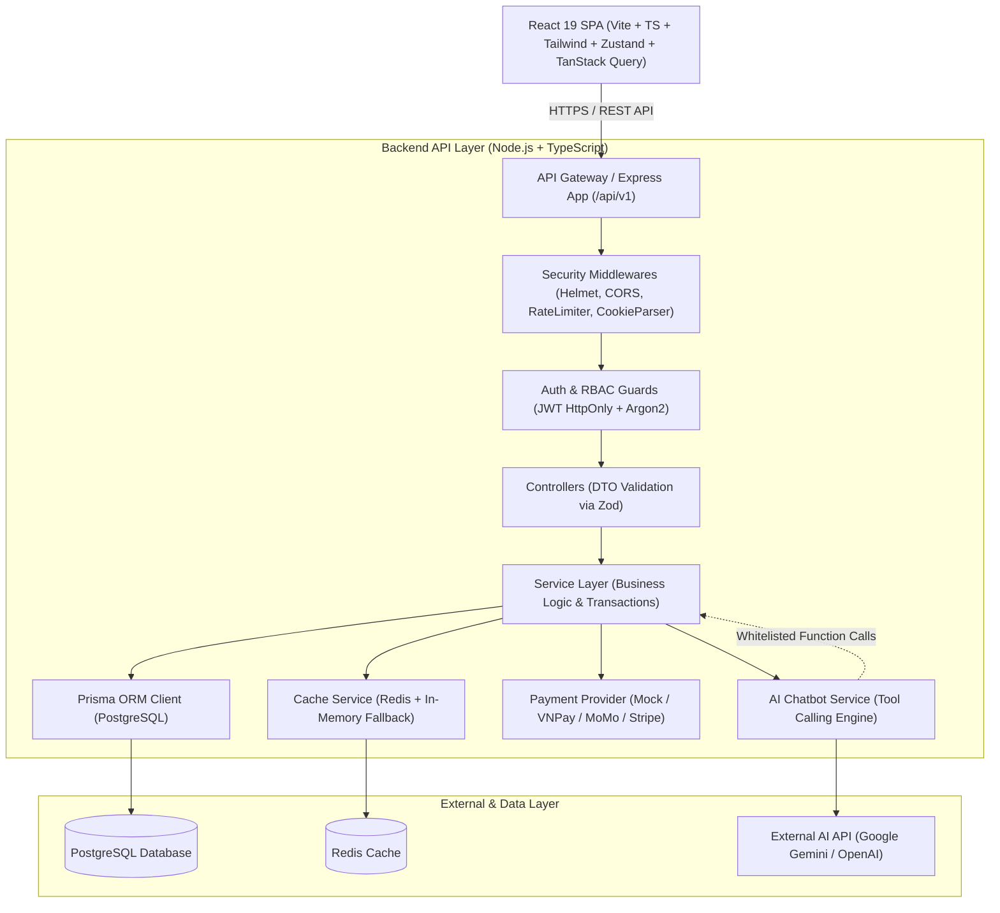

# Kế hoạch Triển khai Web Thương Mại Điện Tử SPA Full-Stack Production-Ready

Hệ thống Thương mại Điện tử SPA Full-Stack hoàn chỉnh được thiết kế theo chuẩn Enterprise/Production-ready với Frontend React TypeScript (Vite, Tailwind CSS, TanStack Query, Zustand, Lucide, Recharts), Backend REST API Node.js/Express TypeScript theo kiến trúc phân lớp (Clean Architecture: Controller - Service - Repository/Prisma), cơ sở dữ liệu quan hệ PostgreSQL với Prisma ORM, Redis Caching, bảo mật OWASP toàn diện, xác thực JWT HttpOnly cookie, phân quyền RBAC đa cấp, xử lý giao dịch đơn hàng (ACID Transactions), trừ kho nguyên tử, hệ thống giảm giá/coupon, trừu tượng hóa cổng thanh toán và trợ lý ảo AI Chatbot thông minh tích hợp Tool Calling (Gemini/OpenAI compatible) với cơ chế bảo vệ chống Prompt Injection.

---

## 1. Kiến trúc Hệ thống Tổng thể (System Architecture)



---

## 2. Cấu trúc Thư mục Dự án Monorepo (Project Structure)

```text
e:\github\webthuongmai/
├── apps/
│   ├── api/                                # Backend REST API (Node.js + Express + TypeScript)
│   │   ├── src/
│   │   │   ├── config/                     # Env & App configurations (Zod validated)
│   │   │   ├── core/                       # Core infrastructure
│   │   │   │   ├── database/               # Prisma singleton & transaction runner
│   │   │   │   ├── redis/                  # Redis client with memory cache fallback
│   │   │   │   ├── logger/                 # Winston structured logging & PII redaction
│   │   │   │   ├── security/               # Rate limiters, argon2, jwt, security headers
│   │   │   │   ├── errors/                 # Typed AppErrors & Global Exception Middleware
│   │   │   │   └── middlewares/            # Request logging, requestId, auth, rbac, validation
│   │   │   ├── modules/                    # Feature Modules
│   │   │   │   ├── auth/                   # Auth (Register, Login, Refresh, Password Reset)
│   │   │   │   ├── user/                   # User profile, Addresses, RBAC management
│   │   │   │   ├── product/                # Products, Variants, Images, Specs, Stock check
│   │   │   │   ├── category/               # Categories hierarchy
│   │   │   │   ├── brand/                  # Brands
│   │   │   │   ├── cart/                   # Server-side Cart & pricing validation
│   │   │   │   ├── order/                  # ACID Order Transaction, Stock decrement, Status state machine
│   │   │   │   ├── coupon/                 # Coupon engine, usage validation & discount calculation
│   │   │   │   ├── payment/                # Payment Provider Abstraction (Mock, VNPay, MoMo, Stripe)
│   │   │   │   ├── review/                 # Verified buyer product reviews & ratings
│   │   │   │   ├── wishlist/               # Customer wishlist
│   │   │   │   ├── admin/                  # Dashboard analytics, revenue charts, low stock alerts
│   │   │   │   └── chat/                   # AI Chatbot Service with Whitelisted Tool Calling
│   │   │   ├── routes/                     # v1 API Router aggregation
│   │   │   ├── swagger/                    # OpenAPI / Swagger Specification
│   │   │   ├── app.ts                      # Express app setup
│   │   │   └── server.ts                   # HTTP Server entrypoint
│   │   ├── tests/                          # Unit & Integration Tests (Vitest / Supertest)
│   │   ├── package.json
│   │   └── tsconfig.json
│   │
│   └── web/                                # Frontend SPA (React + Vite + TypeScript)
│       ├── src/
│       │   ├── api/                        # Axios API Client with Auto-Token Refresh interceptor
│       │   ├── assets/                     # Logos, illustrations, styles
│       │   ├── components/                 # Reusable UI Components
│       │   │   ├── ui/                     # Buttons, Badges, Modals, Inputs, Cards, Dropdowns, Loaders
│       │   │   ├── common/                 # Header, Footer, Navbar, Breadcrumbs, EmptyState, SEOHelmet
│       │   │   ├── product/                # ProductCard, ProductGrid, FilterSidebar, VariantSelector, ImageGallery
│       │   │   ├── cart/                   # CartDrawer, CartItemRow, CouponInput, OrderSummary
│       │   │   ├── checkout/               # StepAddress, StepPayment, OrderReview
│       │   │   └── chat/                   # FloatingChatWidget, ChatMessageItem, ProductSuggestionCard
│       │   ├── features/                   # Feature-specific modules
│       │   │   ├── admin/                  # Admin Dashboard, ProductForm, OrderManager, AnalyticsCharts
│       │   │   └── auth/                   # LoginForm, RegisterForm, ResetPasswordForm
│       │   ├── hooks/                      # Custom hooks (useDebounce, useAuth, useCart, useTheme, etc.)
│       │   ├── layouts/                    # MainLayout, AdminLayout, AuthLayout
│       │   ├── pages/                      # Customer & Admin pages
│       │   │   ├── Home.tsx
│       │   │   ├── Products.tsx
│       │   │   ├── ProductDetail.tsx
│       │   │   ├── Cart.tsx
│       │   │   ├── Checkout.tsx
│       │   │   ├── OrderSuccess.tsx
│       │   │   ├── Orders.tsx
│       │   │   ├── OrderDetail.tsx
│       │   │   ├── Wishlist.tsx
│       │   │   ├── Profile.tsx
│       │   │   ├── Login.tsx
│       │   │   ├── Register.tsx
│       │   │   ├── ForgotPassword.tsx
│       │   │   ├── ResetPassword.tsx
│       │   │   ├── NotFound.tsx
│       │   │   └── admin/                  # Admin pages (Dashboard, Products, Orders, Categories, Coupons)
│       │   ├── routes/                     # React Router routes with ProtectedRoute & AdminGuard
│       │   ├── stores/                     # Zustand stores (useAuthStore, useCartStore, useChatStore, useThemeStore)
│       │   ├── types/                      # Frontend TypeScript interfaces
│       │   ├── utils/                      # Currency formatters, Date formatters, Validation helpers
│       │   ├── App.tsx
│       │   ├── main.tsx
│       │   └── index.css                   # Tailwind CSS & Design tokens
│       ├── package.json
│       ├── tsconfig.json
│       └── vite.config.ts
│
├── packages/
│   └── shared/                             # Shared contracts between Frontend & Backend
│       ├── src/
│       │   ├── constants/                  # Enums (Role, OrderStatus, PaymentStatus, etc.)
│       │   ├── schemas/                    # Zod schemas for Auth, Products, Cart, Orders, AI Chat
│       │   └── types/                      # Common DTOs & API Response envelope types
│       ├── package.json
│       └── tsconfig.json
│
├── prisma/
│   ├── schema.prisma                       # Complete Production Schema (20+ entities)
│   └── seed.ts                             # 50+ Products, 10 Categories, 5 Brands, Admin/Customer accounts
│
├── docker/
│   ├── Dockerfile.api
│   ├── Dockerfile.web
│   └── nginx.conf
│
├── .github/workflows/ci.yml                # CI pipeline (Lint, Typecheck, Test, Build)
├── docker-compose.yml                      # PostgreSQL, Redis, API, Web, Nginx services
├── .env.example
├── package.json                            # Monorepo root with npm workspaces
└── README.md
```

---

## 3. Các Giai đoạn Triển khai Chi tiết (Phases Breakdown)

### Phase 1: Thiết lập Monorepo & Shared Package
- Khởi tạo `package.json` root với npm workspaces (`apps/*`, `packages/*`).
- Tạo package `packages/shared` chứa TypeScript types, Enums (`Role`, `OrderStatus`, `PaymentStatus`, `PaymentMethod`), Zod validation schemas dùng chung cho cả backend và frontend.
- Cấu hình TypeScript, ESLint, Prettier, Scripts đồng bộ.

### Phase 2: Thiết kế Database & Prisma ORM + Seeding Data
- Cấu hình `prisma/schema.prisma` với 20+ models chuẩn quan hệ (1-N, N-N), primary keys (CUID/UUID), composite indexes, foreign keys, unique constraints, updated timestamps:
  - `User`, `Role`, `Permission`, `UserRole`, `Address`, `RefreshToken`, `AuditLog`
  - `Category`, `Brand`, `Product`, `ProductVariant`, `ProductImage`, `Inventory`
  - `Cart`, `CartItem`, `Order`, `OrderItem`, `Payment`, `Coupon`, `CouponUsage`, `Review`, `Wishlist`
  - `ChatConversation`, `ChatMessage`
- Viết `prisma/seed.ts` tự sinh dữ liệu:
  - 1 Super Admin (`superadmin@techstore.vn`), 1 Admin (`admin@techstore.vn`), 5 Customers (mật khẩu đã băm Argon2id)
  - 10 Danh mục công nghệ (Laptops, Smartphones, Audio, Keyboards, Monitors, Smartwatches, Cameras, Gaming Gear, v.v.)
  - 5 Thương hiệu hàng đầu (Apple, Sony, Dell, Asus, Logitech)
  - 50 Sản phẩm chi tiết với ảnh sắc nét, thông số kỹ thuật, biến thể (màu sắc, dung lượng), giá niêm yết, giá khuyến mãi, số lượng tồn kho thực tế
  - Các mã giảm giá hoạt động (`WELCOME10`, `TECHSUMMER`, `FREESHIP`), đánh giá mẫu và lịch sử đơn hàng.

### Phase 3: Backend Core Engine & Security Middleware
- Xây dựng Express TypeScript Application với Clean Layered Architecture:
  - Cấu hình biến môi trường an toàn với Zod validation (`src/config/index.ts`).
  - Prisma Database Client singleton + Redis Cache Client (có In-Memory fallback mượt mà nếu máy người dùng chưa bật Redis service).
  - Winston Structured Logger với Request ID tracking và tự động che giấu thông tin nhạy cảm (PII redaction).
  - Hệ thống Security Middleware: Helmet, CORS Whitelist, Cookie Parser, Compression, Express JSON size limiter.
  - Phân tầng Rate Limiting chuyên biệt (General API: 100 req/min, Auth: 5 req/min, AI Chat: 20 req/min).
  - Global Exception Handler chuẩn hóa response error theo định dạng: `{ success: false, message: string, code: string, errors?: any }`.
  - Tích hợp tài liệu tương tác Swagger/OpenAPI tại `/api/docs`.

### Phase 4: Authentication & Authorization (RBAC) Module
- Triển khai xác thực JWT kép an toàn:
  - Access Token (ngắn hạn: 15 phút) gửi qua header Authorization hoặc cookie.
  - Refresh Token (dài hạn: 7 ngày) được lưu trong **HttpOnly, Secure, SameSite=Strict Cookie** và lưu hash trong database để có thể thu hồi (revoke) khi logout.
  - Băm mật khẩu bằng thuật toán **Argon2id** hiện đại (chống brute-force GPU).
  - API Register, Login, Refresh Token rotation, Logout, Forgot/Reset Password, Profile, Change Password.
  - Middleware `authenticate` và `requireRole([Role.ADMIN, Role.SUPER_ADMIN])` bảo vệ chặt chẽ endpoint từ phía server.

### Phase 5: E-Commerce Product, Category, Brand & Search Engine
- Xây dựng API sản phẩm và tìm kiếm nâng cao:
  - Lọc đa tiêu chí: `category`, `brand`, `minPrice`, `maxPrice`, `rating`, `inStock`, `search` (fulltext/fuzzy), `sort` (price_asc, price_desc, newest, top_rated, popular).
  - Phân trang pagination chuẩn (`page`, `limit`, `total`, `totalPages`).
  - Cache danh mục, sản phẩm nổi bật vào Redis với TTL tự động invalidate khi admin update.
  - CRUD sản phẩm, biến thể, tải ảnh và quản lý tồn kho dành cho Admin.

### Phase 6: Cart & Transactional Order Engine + Payment Abstraction
- **Cart API**: Tính toán giỏ hàng server-side, xác thực sản phẩm còn mở bán, biến thể hợp lệ, giá hiện tại trong DB.
- **Order Engine với ACID Transaction**:
  - Khi đặt hàng: Mở database transaction `prisma.$transaction`.
  - Khóa và kiểm tra tồn kho (Stock check) tránh tình trạng overselling (bán vượt số lượng kho).
  - Xác thực Coupon (hạn dùng, đơn tối thiểu, số lượt đã dùng) và áp dụng giảm giá.
  - Tạo `Order` + `OrderItem` + `Payment` + Trừ số lượng tồn kho `Inventory` nguyên tử.
  - Xóa giỏ hàng sau khi tạo đơn thành công.
- **Payment Abstraction**:
  - Khai báo interface `PaymentProvider` (`createPaymentIntent`, `verifyPayment`, `processRefund`).
  - Cung cấp `MockPaymentProvider` cho phép test đầy đủ mọi trạng thái (PAID, FAILED, PENDING) với QR Code / Thẻ ngân hàng giả lập, sẵn sàng mở rộng sang Stripe, VNPay, MoMo.

### Phase 7: AI Chatbot Service với Tool Calling & Guardrails
- Thiết kế Module AI thông minh (`src/modules/chat/`):
  - Tích hợp Google Gemini API (`@google/genai` hoặc standard REST) / OpenAI provider.
  - Thiết kế System Prompt chuẩn thương mại điện tử chuyên nghiệp, thông minh, lịch sự.
  - **Tool Calling (Function Calling) Engine**: AI không được tự bịa dữ liệu, mà phải gọi các tool backend đã whitelist:
    1. `searchProducts({ query, category, maxPrice, limit })` -> Gọi Service nội bộ để lấy sản phẩm thực tế từ Database.
    2. `getProductDetails({ productId, slug })` -> Lấy thông số kỹ thuật, cấu hình, giá bán, tồn kho.
    3. `checkProductStock({ productId, variantId })` -> Kiểm tra số lượng còn lại trong kho.
    4. `getOrderStatus({ orderCode, email })` -> Kiểm tra trạng thái giao hàng của đơn hàng.
    5. `getStorePolicies({ topic })` -> Hỗ trợ chính sách bảo hành, đổi trả, giao hàng.
  - **Bảo mật AI & Chống Prompt Injection**:
    - Kiểm tra input sanitization, chặn các prompt cố tình trích xuất system prompt, yêu cầu thực thi SQL/Command hay giả danh Admin.
    - AI không bao giờ được cấp quyền sửa DB, thay đổi giá hay xóa đơn hàng.
  - **Lưu lịch sử hội thoại**: Lưu các tin nhắn vào `ChatConversation` và `ChatMessage` theo User/Session để duy trì ngữ cảnh.

### Phase 8: Admin Dashboard & Analytics API
- Thống kê KPI tổng quan: Doanh thu theo ngày/tháng/năm, Tổng số đơn hàng, Khách hàng mới, Sản phẩm sắp hết hàng (Low Stock Warning).
- Doanh thu theo biểu đồ thời gian và cơ cấu trạng thái đơn hàng.
- API quản lý đơn hàng (chuyển trạng thái: Pending -> Confirmed -> Processing -> Shipping -> Delivered / Cancelled).
- API quản lý Coupon, Category, Brand, User Roles và xem Audit Logs hệ thống.

### Phase 9: Frontend Architecture, Design System & Layouts
- Thiết lập React 19 + TypeScript + Vite + Tailwind CSS:
  - Cấu hình Tailwind với bảng màu công nghệ cao cấp (Deep Indigo, Slate Dark, Electric Blue, Emerald Green), Dark/Light theme, glassmorphism, typography chuẩn Google Fonts.
  - Xây dựng hệ thống UI Components tái sử dụng (Button, Input, Badge, Modal, Drawer, Dropdown, SkeletonLoader, Toast, Card, Tooltip, Breadcrumb, Tabs, StarRating).
  - Quản lý Global State với Zustand: `useAuthStore`, `useCartStore`, `useChatStore`, `useThemeStore`, `useWishlistStore`.
  - Quản lý Server State và Cache với TanStack Query.
  - Cấu hình Axios Client tự động gắn JWT và xử lý `401 Unauthorized` bằng cơ chế silent refresh token interceptor.
  - Hệ thống Layouts: `CustomerLayout` (Navbar có thanh tìm kiếm tức thì debounced, giỏ hàng badge, menu tài khoản, Dark Mode, Footer) và `AdminLayout` (Sidebar điều hướng, Header quản trị, thống kê nhanh).

### Phase 10: Frontend Customer Pages & High-Conversion UX
- **Trang chủ (`/`)**: Hero banner chuyển động, Danh mục nổi bật, Flash Sale có đồng hồ đếm ngược, Top sản phẩm bán chạy, Khối giới thiệu AI Assistant, Đánh giá của khách hàng.
- **Trang Catalog & Tìm kiếm (`/products`, `/search`)**:
  - Bộ lọc đa năng bên trái: Lọc theo danh mục (checkbox), thương hiệu, thanh trượt khoảng giá, đánh giá sao, chỉ hiện hàng còn tồn.
  - Sắp xếp (Giá tăng/giảm, Mới nhất, Đánh giá cao nhất), chuyển đổi Grid view / List view, phân trang mượt mà.
  - Thanh tìm kiếm thông minh với Debounce 300ms hiển thị kết quả gợi ý tức thì.
- **Trang Chi tiết Sản phẩm (`/products/:slug`)**:
  - Bộ sưu tập ảnh với tính năng zoom và chọn thumbnail.
  - Chọn biến thể trực quan (Màu sắc, Dung lượng/Cấu hình) tự động cập nhật giá và số lượng kho.
  - Nút Thêm vào giỏ hàng và Mua ngay có hiệu ứng micro-animation.
  - Bảng thông số kỹ thuật chi tiết, khu vực đánh giá có gửi review kèm xếp hạng sao, danh sách sản phẩm tương tự.
- **Trang Giỏ hàng & Thanh toán (`/cart`, `/checkout`)**:
  - Giỏ hàng: Cập nhật số lượng tức thì, xóa món, nhập mã khuyến mãi giảm giá trực tiếp, tính tổng tiền rõ ràng.
  - Thanh toán: Nhập địa chỉ giao hàng, chọn phương thức thanh toán (Thẻ tín dụng giả lập, QR Chuyển khoản, COD), xem lại đơn hàng và Đặt hàng an toàn với 1 click.
- **Trang Quản lý Đơn hàng (`/orders`, `/orders/:id`)**:
  - Danh sách đơn hàng với bộ lọc trạng thái.
  - Chi tiết đơn hàng với Stepper tiến trình vận chuyển trực quan (Chờ xác nhận -> Đang xử lý -> Đang giao -> Đã giao).
- **Trang Wishlist, Profile, Authentication**: Đăng nhập, Đăng ký, Quên mật khẩu, Đổi mật khẩu với validation React Hook Form + Zod, hỗ trợ nút Quick Fill Demo Accounts tiện lợi cho người dùng thử nghiệm ngay.

### Phase 11: Frontend AI Chatbot Widget & Trải nghiệm Mua sắm Thông minh
- **Widget Chatbot Nổi (Floating Widget)** ở góc phải màn hình:
  - Nút bấm tròn phát sáng viền nhẹ nhàng, click mở rộng khung chat hiện đại.
  - Khung chat hỗ trợ Quick Action Chips: *"Tìm laptop lập trình dưới 25 triệu"*, *"Tư vấn tai nghe chống ồn"*, *"Kiểm tra đơn hàng #..."*, *"Chính sách bảo hành"*.
  - Hiệu ứng gõ chữ (Streaming/Typing indicator), hiển thị trạng thái AI đang gọi tool (`🔍 Đang kiểm tra tồn kho và cấu hình...`).
  - **Interactive Product Suggestion Card**: AI trả về thẻ sản phẩm có ảnh, giá, nút "Xem chi tiết" và nút "Thêm vào giỏ hàng" trực tiếp ngay trong đoạn chat.

### Phase 12: Frontend Admin Dashboard & Quản trị Hệ thống
- **Admin Dashboard (`/admin`)**:
  - 4 Thẻ chỉ số chính: Doanh thu tổng, Đơn hàng thành công, Khách hàng hoạt động, Sản phẩm cảnh báo sắp hết hàng.
  - Biểu đồ Recharts: Doanh thu theo tháng/ngày (Area Chart), Tỷ lệ đơn hàng theo trạng thái (Donut Chart).
- **Quản lý Sản phẩm (`/admin/products`)**: Bảng dữ liệu có tìm kiếm, lọc danh mục, chỉnh sửa giá, cập nhật kho, Modal Thêm/Sửa sản phẩm với biến thể.
- **Quản lý Đơn hàng (`/admin/orders`)**: Danh sách đơn hàng, xem chi tiết sản phẩm, cập nhật trạng thái đơn hàng trực tiếp.
- **Quản lý Danh mục & Mã giảm giá (`/admin/coupons`, `/admin/categories`)**: Tạo mã khuyến mãi mới, cài đặt ngày hết hạn, tỷ lệ giảm giá, giới hạn sử dụng.

### Phase 13: Tests, Dockerization, CI/CD & Production Documentation
- Viết bộ kiểm thử Unit & Integration Tests cho Auth, Product Search, Cart/Order Transactions, RBAC, AI Tool Calling.
- Docker Compose:
  - `postgres`: PostgreSQL 16 Alpine
  - `redis`: Redis 7 Alpine
  - `api`: Node.js Backend container
  - `web`: Nginx + Built React SPA container
  - `docker-compose.yml` cấu hình mạng nội bộ và volume lưu trữ dữ liệu bền vững.
- GitHub Actions CI workflow (`.github/workflows/ci.yml`).
- `README.md` hướng dẫn chi tiết từ cài đặt, chạy dev, chạy seed, chạy docker, danh sách API, tài khoản demo và tài liệu kiến trúc.

---

## 4. Kế hoạch Xác minh & Kiểm thử (Verification Plan)

### Automated Tests
- Chạy unit tests và integration tests backend với `npm run test --workspace=apps/api`.
- Kiểm tra TypeScript Typecheck toàn monorepo: `npm run typecheck`.
- Chạy build production bundle cho cả web và api: `npm run build`.

### Manual Verification
- Khởi động backend API và frontend Vite dev server (`npm run dev`).
- Xác thực đăng nhập tài khoản Admin và Customer.
- Thử nghiệm tìm kiếm, lọc sản phẩm theo danh mục và khoảng giá.
- Thử nghiệm luồng mua hàng: Thêm vào giỏ -> Nhập mã giảm giá -> Đặt hàng -> Kiểm tra số lượng tồn kho bị trừ chính xác.
- Thử nghiệm AI Chatbot: Hỏi câu hỏi tư vấn sản phẩm, so sánh và kiểm tra xem AI có gọi tool chính xác để lấy sản phẩm từ DB và hiển thị thẻ sản phẩm tương tác không.
- Thử nghiệm Dashboard Admin: Kiểm tra biểu đồ doanh thu và cập nhật trạng thái đơn hàng.
